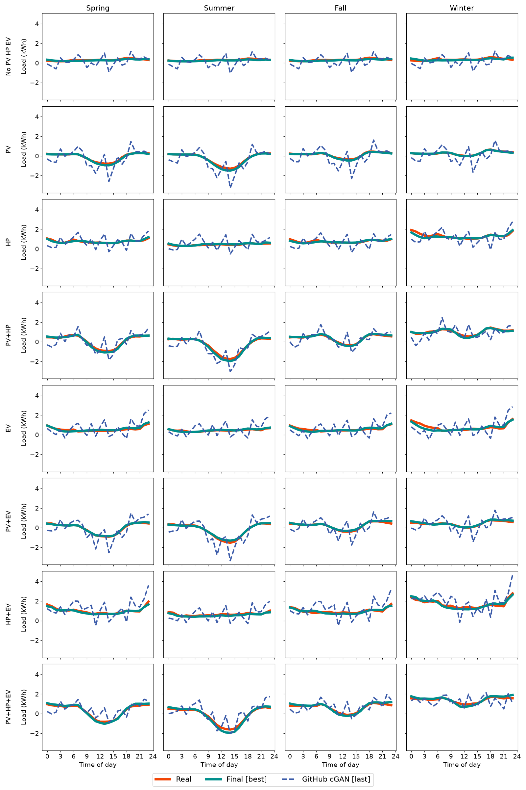

# Conditional GAN for residential load profiles with PV, heat pumps and EVs

**Fluvius 2024 smart-meter data · hourly net load · 64 conditions · evaluation on unseen households**

In this repository I test how well the conditional GAN of Li, Dong & Qiu (2025)
generates daily electricity load profiles on a data set it was not developed
for, and I develop an improved version of it.  The published model was trained
and validated on 110 households in the United States.  I apply it to 2,367
Flemish households from the Fluvius 2024 open smart-meter sample and evaluate
every model on households it has never seen.

The work answers two questions:

1. Does the published model, with its original code and hyper-parameters, carry
   over to a different population?
2. If it does not, which changes are needed, and how much does each of them
   contribute?

## Main findings

- **The published model does not carry over as released.**  Trained on the
  Fluvius data it reaches a statistical accuracy of 48.3 ± 1.3 % on held-out
  households.  Its training oscillates, and its average days zig-zag from hour
  to hour.
- **My final model reaches 87.9 ± 0.2 %** over five training seeds (95 %
  interval over households: 86.4–89.3 %).  Real days of the training households
  score 87.9 % against the same test households, and real days of the
  validation households 86.1 %.
- **Most of the gain comes from how the data are fed to the networks, not from
  the networks or the loss.**  Reshuffling the minibatches (+11.2 points) and a
  per-hour value transform (+21.1 points) lift the original networks from
  54.8 % to 87.2 % (one seed).
- **Generated days are close to real days, but not indistinguishable from
  them.**  A classifier separates the two with an AUC of 0.61, and a stronger
  one with 0.70, where 0.5 would mean indistinguishable.

<p align="center">
  
</p>

*Average weekday profile per technology group and season on the held-out test
households: real data, my final model and the reference model.*

## Data

| | |
|---|---|
| Source | Fluvius 2024 sample: 2,400 residential digital meters with quarter-hourly grid import and export for the whole year |
| Target | hourly **net load** = import − export (kWh), 24 values per day; negative while PV exports |
| Conditions | 64 labels = day type (weekday / weekend and Belgian public holidays) × technology group (the eight combinations of PV, heat pump and EV) × season |
| Cleaning | 33 duplicated meters, the two daylight-saving days and 866 meter-days without any flow are removed |
| Split | by household, stratified by technology group: 1,657 training / 356 validation / 354 test households (602,356 / 129,540 / 128,826 days) |

The models and the scaling see only the training households.  The validation
households select checkpoints and models, and the test households give every
number reported below.

Two differences from the paper matter.  The Fluvius data have no information
on EV charger levels, so I replace the paper's three charger classes by the
heat-pump indicator, which keeps eight technology groups and 64 labels.  And my
target is net load, which is negative while PV exports, whereas the reference
code discards days with negative values.

The raw data are in the
[`data` release](https://github.com/MahmoudAsadi97/Cgan_Research_2026/releases/tag/data)
of this repository.

## Method

I train two models on the same households.

**Reference model (`faithful`).**  The published code
([malvin0130/cGAN_EB](https://github.com/malvin0130/cGAN_EB)) with its original
networks and hyper-parameters: 24-dimensional noise and a one-hot label,
generator 64-128-64, discriminator 64-128-256 with dropout, binary
cross-entropy, batch size 2,000 and 10,000 epochs.  I report its final weights,
as the paper does, and also the checkpoint with the best validation score.

**Final model (`final`).**  The same conditional set-up with six changes:

| Change | Reference | Final | Reason |
|---|---|---|---|
| Minibatches | fixed order, the same every epoch | reshuffled every epoch | ordered batches hold one technology group at a time |
| Value scaling | global min-max | per-hour mapping to a standard normal distribution | net load is heavy-tailed; min-max squeezes ordinary loads into a narrow band |
| Loss | binary cross-entropy | Wasserstein loss with gradient penalty | stable training; the original training oscillates |
| Networks | 64-128-64 and 64-128-256, noise 24 | 4 × 512 for both, noise 64; the critic also sees hour-to-hour changes | capacity for 64 labels with very different shapes |
| Weights used | last iterate | moving average, best validation checkpoint | removes the oscillation between iterates |
| Physical constraint | none | net load ≥ 0 kWh for labels without PV | a meter without PV cannot export |

I chose the final configuration among four candidates on the validation
households, with a rule fixed before the comparison (highest validation
accuracy, the simpler model if two are within 0.1 point), and then trained it
with five seeds.

## Evaluation

For every label the generator produces as many days as the test households
have, and all metrics are computed per label and averaged over the 64 labels.

- **Statistical accuracy** is the main metric, with a target of 85 %.  It
  turns the comparisons the paper uses to validate its model into four equally
  weighted scores: the average daily profile, the hourly standard deviation,
  the mean and standard deviation of the key load-shape parameters (near-peak
  and near-base load, peak duration, rise time, fall time, daily energy), and
  the full distributions of the hourly values and of these parameters.  A model
  that reproduces only the average day scores below 50 %.
- **Acceptance levels of the paper**: the share of label and key-parameter
  pairs with a difference of the mean and of the standard deviation below 1,
  a KL divergence below 0.3 and an FID below 5.
- **Realism and memorisation**: the relative Fréchet distance of the 24-hour
  profiles (rFD), a classifier two-sample test (C2ST), coverage, the distance
  of generated days to the closest training day (DCR ratio) and the share of
  negative load for households without PV.
- **Real-data benchmarks**: real days of the validation and of the training
  households, scored against the test households with the same metrics.  They
  show how close real homes of the same population come to the test homes.
- **Uncertainty**: ± is the standard deviation over training seeds; intervals
  over households come from stratified half-sampling of the test households.

## Results

### Final model against the reference model

Held-out test households (354 households, 128,826 days).

| Model | Statistical accuracy (%) | Worst label (%) | rFD ↓ | C2ST AUC (0.5 ideal) | Coverage ↑ | DCR ratio (≈ 1) | Negative load, no PV |
|---|---|---|---|---|---|---|---|
| Reference, last iterate (3 seeds) | 48.3 ± 1.3 | 27.4 ± 5.5 | 1.40 | 1.00 | 0.04 | 2.00 | 21.9 % |
| Reference, best checkpoint (3 seeds) | 55.1 ± 0.6 | 39.8 ± 4.1 | 0.91 | 1.00 | 0.06 | 1.51 | 18.2 % |
| **Final (5 seeds)** | **87.9 ± 0.2** | 74.6 ± 0.6 | **0.117** | 0.61 | 0.81 | 1.01 | **0** |
| Real days, validation households | 86.1 | 76.9 | 0.167 | 0.50 | 0.79 | 1.02 | 0 |
| Real days, training households | 87.9 | 70.6 | 0.132 | 0.49 | 0.82 | – | 0 |

- All five seeds meet the 85 % target (87.6–88.1 %).
- The final model is 39.5 points above the reference model (95 % interval
  38.3–40.7) and better on every ranked metric for every seed.
- The DCR ratio of about 1 gives no sign that the model copies training days.

### Contribution of each change

Each row adds one change to the row above it.

| Step | Change added | Seeds | Test accuracy (%) |
|---|---|---|---|
| `faithful` | reference model, best checkpoint | 3 | 55.1 ± 0.6 |
| `abl_shuffle` | + reshuffled minibatches | 1 | 66.1 |
| `abl_quantile` | + per-hour value transform | 1 | 87.2 |
| `abl_wgan_refnets` | + Wasserstein training, reference networks | 3 | 83.7 ± 0.3 |
| `abl_wide` | + 3 × 256 networks | 3 | 87.1 ± 0.2 |
| `abl_ema` | + averaged weights | 3 | 87.5 ± 0.3 |
| `improved` | + no-PV floor | 5 | 87.5 ± 0.2 |
| `improved_big` | + 4 × 512 networks | 5 | 87.8 ± 0.1 |
| `final` | + hour-to-hour changes for the critic | 5 | 87.9 ± 0.2 |

The two data-handling changes carry most of the gain.  Wasserstein training
with wider networks and averaged weights adds 0.5–0.7 points of accuracy, which
is within the seed spread of the original training.  Its main effect is that
single days become more realistic (C2ST AUC 0.70 → 0.61, rFD 0.137 → 0.117) and
that training is more stable.  The simpler model `abl_quantile` is better on
the worst label (78.9 % against 74.6 %) and on the key-parameter FID (0.69
against 0.85), so it remains a serious alternative to the final model.

### Acceptance levels of the paper

Share of label and key-parameter pairs that meet each level on the held-out
test households, with the definitions of the paper.

| Level | Reference model (last iterate) | Final model |
|---|---|---|
| Difference of the mean below 1 | 54 % | 99 % |
| Difference of the standard deviation below 1 | 78 % | 100 % |
| KL divergence below 0.3 | 7 % | 100 % |
| FID below 5 | 71 % | 100 % |

### Comparison with the published figures

I also digitised the heatmaps of the paper and repeated its validation for all
seeds.  The data sets differ in country, labels and load definition, so this
shows whether the levels reported in the paper are reached here.  It is not a
ranking of the two models.

- **Time parameters** (peak duration, rise and fall time): the mean is within
  1 h of the real mean for 100 % of the pairs with the protocol of the paper
  and for 98.8 ± 0.5 % on held-out households.  In the figures of the paper
  this share is 79.7 %, and the reference model reaches 39 % on my data.
- **Load parameters**: with a bar scaled to the smaller loads of this data set,
  the final model stays below the shares of the paper on held-out households
  (74–94 % against 98–100 %).  Real days of the training households stay below
  them as well (78–92 %), so the gap cannot be attributed to the model alone.

## Limitations

- The paper's data are not public.  The only like-for-like comparison is the
  one with the reference code trained on the same households.
- One development run was scored on the test households before the final
  candidates were defined.  All later choices used the validation households
  only, with the selection rule fixed beforehand.
- The steps `abl_shuffle` and `abl_quantile` of the ablation have one seed each.
- I have not yet evaluated classical generators, such as copula or mixture
  models, with this protocol.
- The technology labels are registry indicators: a household without the EV
  flag may still own an EV.  The data cover one region and one year.

## Reproducing

```bash
python -m venv .venv
source .venv/bin/activate                              # Windows: .venv\Scripts\activate
pip install torch==2.11.0 --index-url https://download.pytorch.org/whl/cu128
pip install -r requirements.txt

mkdir -p data/raw
curl -L -o data/raw/raw.zip https://github.com/MahmoudAsadi97/Cgan_Research_2026/releases/download/data/raw.zip
python data_prep.py                                    # hourly profiles, labels and household split (~1 min)
python -m pytest                                       # unit tests

python run_jobs.py jobs/variants.txt --parallel 3      # selection candidates and reference model, seed 0
python run_jobs.py jobs/final.txt --parallel 3         # final model, five seeds
python run_jobs.py jobs/ablation.txt --parallel 3      # remaining reference seeds and the ablation
python evaluate.py --run runs/final/seed0 --ckpt best  # evaluate one run
```

Training resumes from the last checkpoint when a job file is run again.  The
commands for the result tables, the figures, the uncertainty estimates and the
comparison with the paper are in the
[technical notes](docs/technical_notes.md#reproducing).

## Repository layout

| Path | Content |
|---|---|
| `data_prep.py` | raw data to hourly profiles; labels, cleaning and household split |
| `cGAN.py`, `train.py` | reference and final models, training configurations, checkpoints |
| `metrics.py`, `evaluate.py`, `report.py` | metrics, evaluation of a run, result tables and figures |
| `uncertainty.py`, `reliability.py` | intervals over households |
| `compare_paper.py` | comparison with the published figures of the paper |
| `jobs/` | job files of all experiments |
| `results/` | result tables, figures and 2,000 generated days per label of the final model |
| `docs/technical_notes.md` | full details: data preparation, model selection, metric definitions, protocol notes |
| `LICENSE-cGAN_EB` | MIT licence of the reference code that `cGAN.py` and `utils.py` adapt |

## References

- Li, Y., Dong, B., Qiu, Y. (2025). Conditional generative adversarial network (cGAN) for generating building load profiles with photovoltaics and electric vehicles. *Energy and Buildings* 335, 115584. https://doi.org/10.1016/j.enbuild.2025.115584
- Price, P. N. (2010). Methods for analyzing electric load shape and its variability. LBNL-3713E.
- Gulrajani, I., Ahmed, F., Arjovsky, M., Dumoulin, V., Courville, A. (2017). Improved training of Wasserstein GANs. NeurIPS.
- Yazıcı, Y. et al. (2019). The unusual effectiveness of averaging in GAN training. ICLR.
- Naeem, M. F., Oh, S. J., Uh, Y., Choi, Y., Yoo, J. (2020). Reliable fidelity and diversity metrics for generative models. ICML.
